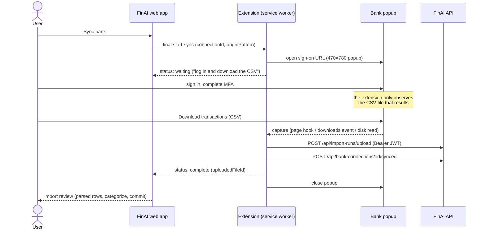
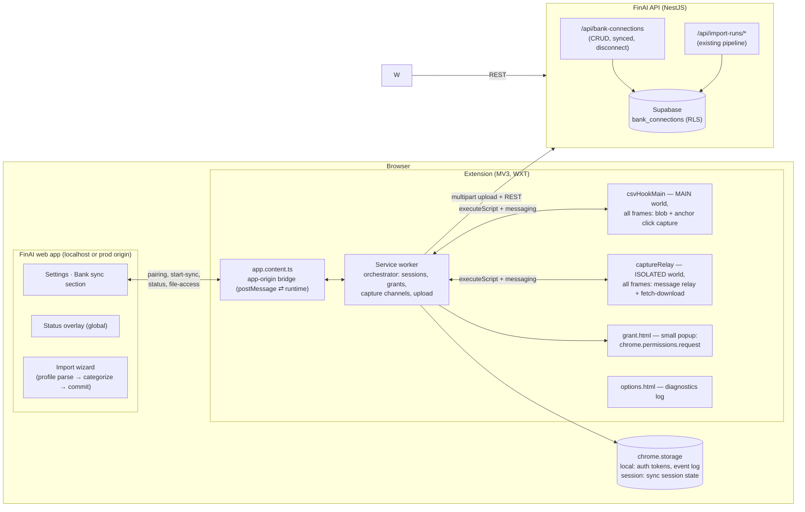
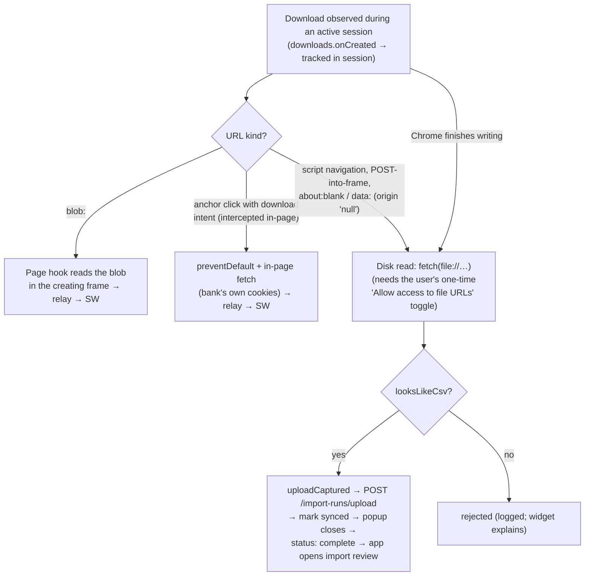
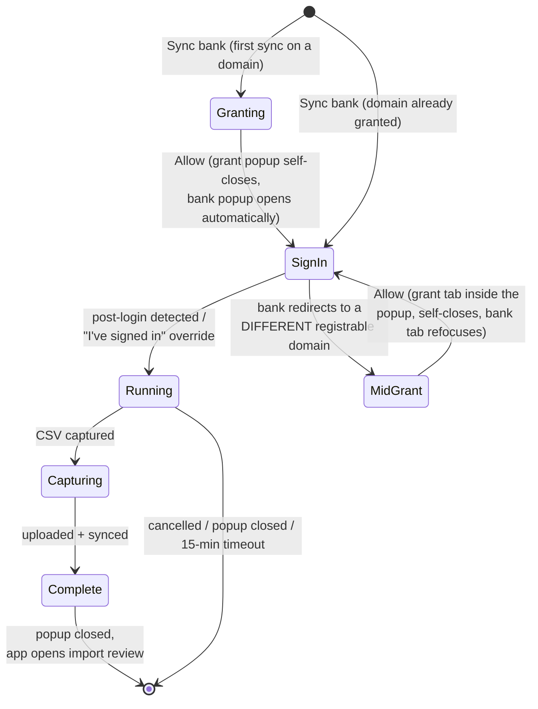

# Bank Sync — design & reference

*Status: MVP, implemented and covered by an automated browser E2E (`scripts/extension-e2e.mjs`, 6 phases). This document is the detailed reference; the README carries only a short summary.*

---

## 1. Overview

Bank Sync lets FinAI users pull transaction CSVs out of their banks' websites **without FinAI ever seeing, storing, or replaying their credentials**. A Chrome/Edge MV3 extension (`apps/extension`) opens the bank's own online-banking page in a small popup; the user signs in and downloads the CSV exactly the way they always have; the extension observes *that one download*, uploads the file through FinAI's existing CSV import pipeline, and returns the user to the app's import-review screen.

The design is deliberately **manual and dumb**:

- There are **no recorded recipes, no replay engine, no headless scraping**. Banks change their UIs constantly; anything scripted breaks. The only "automation" is opening the tab and watching for one file.
- The user is **always the operator**: they type credentials, they answer MFA, they click *Download*. FinAI only ever reads the *file that results* — and even then, committing anything to the ledger happens in FinAI's normal import-review flow.
- Recipes/connections are **per-user data** (`bank_connections`, RLS-scoped). Nothing bank-specific is shipped in the extension except a tiny generic capture engine.
- There is **no curated bank list**. The user pastes their bank's online-banking URL; the extension derives a permission scope from it.

Why a browser extension at all? Banks won't let their pages be embedded (`X-Frame-Options`), their export endpoints use one-time tokens and per-session cookies, and no regulated open-banking API is available to individuals in Canada yet (the Consumer-Driven Banking framework is still pre-launch — see §8). An extension running with per-domain user consent is the only architecture that satisfies *manual operation + zero credential handling + works with any bank*.

---

## 2. User journey

### 2.1 First-time setup (once per browser, once per bank)

1. **Install the extension** (Chrome → `chrome://extensions` → *Load unpacked* → `apps/extension/dist/chrome-mv3`). At install the extension requests only FinAI's own origin.
2. **Pair**: open an account's settings page (*Transaction* → account card → *Settings* → **Bank sync** — the feature is per-account, not in the main Settings view). The app detects the extension (content-script bridge on the app's origins) and hands it the API base URL plus the current Supabase session tokens. The extension refreshes its own sessions afterwards, so syncs work even with the FinAI tab closed.
3. **Connect a bank**: pick the FinAI account it feeds, paste the bank's online-banking URL (e.g. `https://www.cibconline.cibc.com/...`). Chrome asks for permission for that domain **plus a wildcard over its registrable domain** (`cibc.com` → `*.cibc.com`) — one dialog covering the whole bank family, including wherever the bank actually serves sign-on and downloads.
4. **Optional one-time toggle**: enable *"Allow access to file URLs"* on the extension's details page. This lets FinAI read CSVs Chrome has already saved to `~/Downloads` — required for banks whose export links are one-time tokens. Settings shows a reminder card until it's on.

### 2.2 Every sync



The user experience is: *press Sync → a small bank window opens → sign in, download like always → FinAI takes over*. Nothing new to learn; no credentials ever typed anywhere except the bank's own page.

---

## 3. Software architecture



### 3.1 Extension components (`apps/extension`)

| Piece | Role |
|---|---|
| `entrypoints/background.ts` | The orchestrator. Owns pairing tokens, the single sync session (persisted in `chrome.storage.session` so MV3 idle-kill can't lose it), grant flow, and the capture channels. |
| `entrypoints/app.content.ts` | Content script on FinAI's origins only. Relays `window.postMessage` ⇄ `chrome.runtime` between the web app and the worker. This is the pairing channel — the only place session tokens move, device-locally. |
| `entrypoints/grant/` | Small popup window that calls `chrome.permissions.request` (must run inside an extension page with a user gesture). Logs its own progress; sets a readiness flag for automation. |
| `entrypoints/options/` | Diagnostics page: pairing state, granted origins, and the ring-buffer event log (`finai.log`) — every meaningful stage is recorded. |
| `lib/messages.ts` | Extension-internal message types. App-visible bridge messages are zod-validated in `shared-types/bank-sync.ts`. |

### 3.2 Injected capture engine (two worlds)

- **`csvHookMain`** (MAIN world, `allFrames: true`) runs in the bank's own JS context, where it can:
  - patch `URL.createObjectURL` + `HTMLAnchorElement.prototype.click` to read **blob-URL CSVs** the page creates (typical SPA exports — CIBC);
  - intercept **download-intent anchor clicks** (`download` attribute / `.csv` / `download|export` in the URL), `preventDefault()`, fetch the file **in-page with the bank's cookies**, and hand the bytes to the relay. If the in-page fetch fails, it degrades to the native navigation so the user always gets their file;
  - it never touches login forms, passwords, or MFA codes — it only observes downloads.
- **`captureRelay`** (isolated world, `allFrames: true`) relays the hook's captures to the service worker and serves `fetch-download` (re-fetching direct URLs with tab cookies) for the worker.

Both are re-injected idempotently on every page load/navigation inside granted origins (banks navigate between SPA routes mid-login; EQ-style UIs live in iframes — `allFrames` is why capture works there).

### 3.3 Capture channels (first one that produces a CSV wins)



Rules that make the funnel safe:

- **Time-scoped**: capture runs only while a sync session is active (pressed *Sync bank*; expires after one capture or 15 min).
- **Origin-scoped**: only downloads whose URL origin (or referrer origin, for the `about:blank` case) is inside the granted host permissions — checked via `chrome.permissions.contains`, so wildcard coverage is Chrome's own logic.
- **Session-scoped**: candidates are tracked per session, and a download only counts if Chrome **started it during this session** (`startTime ≥ session.startedAt`) — a late completion event from the *previous* sync can never capture into the new one.
- **Content-validated**: `looksLikeCsv` rejects JSON error bodies and HTML pages (real failures seen in the wild: Supabase storage error JSON, bank auth redirects).
- **First capture wins** (session `captured` flag); all later events for that download are ignored.

**Why there is no single universal channel**: Chrome has no API to read the content of a download (`downloads` gives metadata only; `webRequest` can't read bodies in MV3). The disk read is the closest to universal — every download ends up as a file — but it requires the user's file-URL toggle and adds a small delay, so the in-page channels (instant, no toggle) stay as fast paths. The original server-worker re-fetch channel was removed: re-fetching one-time-token URLs produced error bodies, and it depended on the fragile event-wake behavior.

### 3.4 Session & grants



- **One grant up front**: connecting requests the pasted origin plus `https://*.<registrable-domain>/*` (small multi-part-suffix list for `co.uk`-style TLDs; `localhost`/IPs stay exact-only). This is why `cibc.com` covers `cibconline.cibc.com` — no prompts during login.
- **Mid-flow grant** exists only for cross-registrable-domain redirects (AMEX: `amex.ca` → `americanexpress.com`). It appears as a sibling tab *inside* the bank popup, activates itself, and self-closes after granting; `grant-done` adopts the new origin, re-injects, and refocuses the bank tab. Dedup via `grantsRequested` so it appears once per domain.
- **The session survives worker death**: MV3 kills an idle service worker after ~30 s and does **not** reliably wake it for `downloads` events. Mitigations: session state in `chrome.storage.session` (hydrated by every handler) and a `chrome.alarms` sweep (30 s) that polls `downloads.search` for completed-but-uncaptured session candidates and disk-reads them.

### 3.5 API & data model

- `bank_connections` (`20261108130000_bank_sync_simplify.sql`): `id, user_id, account_id (unique FK → accounts, on delete cascade), bank_slug, login_url, status ('active'|'disconnected'), last_synced_at, timestamps`. RLS via `current_app_user_id()`, plus an `is_owned_account` CHECK so a connection can never reference another user's account.
- `bank_recipes` existed during the recipe prototype and was dropped by the same simplification migration.
- Endpoints (`apps/api/src/modules/bank-connections/`): `GET/POST /api/bank-connections`, `POST /:id/synced`, `PATCH /:id/disconnect`. Capture uploads reuse the existing `POST /api/import-runs/upload`; nothing in the import pipeline changed.

---

## 4. Security model

| Question | Answer |
|---|---|
| Who handles credentials? | Only the user, on the bank's own page. The extension never reads, fills, stores, or logs them; the click-capture excludes login forms entirely. |
| What does the extension read? | The bytes of CSV files downloaded from user-granted bank origins during an active sync session — and, with the file-URL toggle on (optional), the same files Chrome already wrote to `~/Downloads` (needed only for banks whose export links are one-time tokens). Nothing else. |
| What is stored? | Auth tokens (Supabase session, same as the app's) in `chrome.storage.local`; session state + event log in `storage.session`/`local`. No bank credentials anywhere. |
| What can it do to the ledger? | Nothing directly: it can only upload a file for review. Committing transactions still requires the user in FinAI's review UI. |
| Permission scope | Install-time: FinAI's origins + `file:///*` (inert until the user's manual toggle). Per-connection: the pasted origin + registrable-domain wildcard, granted by the user in Chrome's own dialog. |
| Cross-user isolation | All server-side state is RLS-scoped; the extension operates only with the paired user's JWT. |

Honest tradeoffs: scraping a bank's site is against most banks' ToS letter (their own supported CSV export is being automated with the user present); the file-URL toggle is broad and user-opt-in (documented in-app); and the extension is only as trustworthy as its distribution channel (Chrome Web Store review is the plan before public distribution).

---

## 5. Testing

- **Automated**: `node scripts/extension-e2e.mjs` launches real Chrome with the extension and runs six phases against an in-repo mock bank (`apps/web/public/mock-bank/`, sign-on code `246810`):
  1. blob-CSV capture (SPA-style export),
  2. direct-URL `Content-Disposition` capture,
  3. same-domain redirect (`www.mock-bank.test` → `online.mock-bank.test`) with the single up-front grant,
  4. framed banking (the entire UI inside an iframe — EQ-style),
  5. one-time-token export forcing the disk-read channel,
  6. `data:`-URL export (unresolvable origin — EQ's `about:blank` pattern).
  For determinism the E2E **patches a copy of the built manifest** to pre-grant the mock host patterns, so no native permission dialog appears in automation; the grant-page UX itself is verified manually (Chrome's dialog needs a human click).
- **Diagnostics**: the extension's Options page (`chrome://extensions` → Details → Extension options) shows pairing state, granted origins, and the event log (`paired`, `start-sync`, `download-observed`, `capture-ok`, `upload-ok`, `disk-read-*`, `injection-*`, …). Failures are designed to be legible there first.
- **Unit**: `bankSlugFromLoginUrl` (API service) and the rest of the API suite (24 tests).

---

## 6. Observed browser quirks (and their workarounds)

These are documented because they shaped the architecture and will bite anyone maintaining it:

1. **MV3 service workers idle-die after ~30 s**, and `chrome.downloads` events do **not** reliably wake them (observed directly: a completed download present in `downloads.search` with no `onCreated` delivery). Session state is therefore persisted in `chrome.storage.session` and a `chrome.alarms` sweep polls for uncaptured candidates.
2. **A page navigation unloads the injected relay** — a direct download (`location.href = 'export.csv'`) would kill the capture context at the worst moment. The click-capture intercepts *before* navigation and fetches in-page instead.
3. **`chrome.windows.create` from a service worker can lie about width/height** in its result object. Real bounds are re-checked with `windows.get` and re-asserted with `windows.update`.
4. **`about:blank`-attributed downloads** (bank POSTs into hidden frames): `item.url.origin` is the string `"null"` with an empty filename. Handled via referrer hints + the disk-read channel.
5. **`chrome.permissions.request` must be the first thing after the user gesture** — an `await`ed storage write before it consumed the gesture state and Chrome hung the request forever (observed). The grant handler does no async work before the call.
6. **Concurrent `runtime.sendMessage` while the native permission dialog is open breaks it** (the prompt never resolves — observed). A keep-alive ping loop was tried and removed for exactly this reason; the alarm sweep covers worker wake-up instead. Corollary: never do async work in a grant-page handler before `permissions.request` — an awaited storage write consumes the user-gesture state and the request hangs forever.
7. **`chrome.tabs.query`/match-patterns with wildcard + port are unreliable** — admission checks use `permissions.contains` (Chrome's own pattern-overlap logic) rather than string matching.
9. **Deployed origins**: `APP_ORIGIN` env at extension build time adds the production app origin to the bridge content script + host permissions (`pnpm --filter extension run build` with `APP_ORIGIN=https://finai.example.com`). Without it the bridge only runs on localhost.
8. **Vite 8 dev server rejects unexpected `Host` headers** — `allowedHosts` includes the E2E's fake bank hosts; Chrome maps them to `127.0.0.1` via `--host-resolver-rules`.

---

## 7. File map

```
apps/extension/
  entrypoints/background.ts     # orchestrator (sessions, grants, capture, upload)
  entrypoints/app.content.ts    # app-origin pairing/status bridge
  entrypoints/grant/            # permission popup window
  entrypoints/options/          # diagnostics page
  lib/messages.ts               # extension-internal message types
  lib/app-origins.ts            # app origins (build-time APP_ORIGIN env)
apps/api/src/modules/bank-connections/
  bank-connections.{controller,service}.ts
supabase/migrations/20261108130000_bank_sync_simplify.sql
packages/shared-types/src/bank-sync.ts
apps/web/src/
  features/settings/BankSyncSection.tsx   # per-account connect/sync UI (used by AccountSettingsPage)
  features/bank-sync/BankSyncOverlay.tsx  # global status widget + handoff
  hooks/useBankSync.ts
  lib/extensionBridge.ts
  public/mock-bank/                       # mock bank (6 test modes)
scripts/extension-e2e.mjs                  # 6-phase browser E2E
```

## 8. Known limitations & future work

- **ToS**: automating the export click-through is against most banks' letter-of-ToS; the feature automates the bank's own supported CSV export with the user present. Positioning stays "user-driven import," never background scraping.
- **Cross-registrable-domain banks** (AMEX) need the connection created with a URL on the download domain, or the (already-built) mid-flow grant, which automation can't exercise — verify manually.
- **Background/absent syncs** are intentionally out of scope: syncs require the user present (which mandatory MFA effectively requires anyway). If silent capture is ever wanted, the natural evolution is the documented-recipe model — deliberately deferred until real usage demands it.
- **Store distribution**: pairing was designed to not depend on the extension ID, so publishing to the Chrome Web Store later requires no app changes beyond packaging (`pnpm --filter extension zip`).
